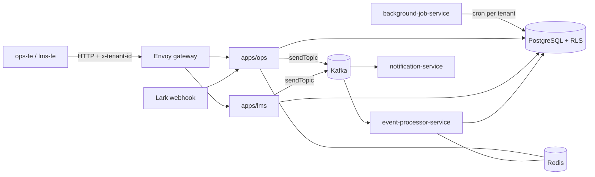
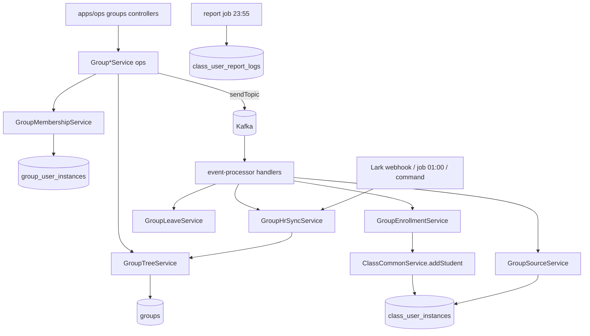
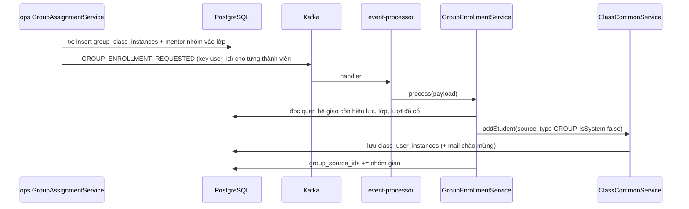
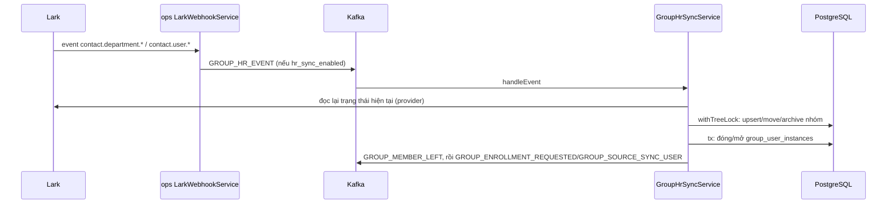

# Architecture — lms-be

> `origin/staging` @ `a2f4821`. Chi tiết từng chức năng nhóm: [areas/group.md](areas/group.md). Cấu trúc thư mục: [code-structure.md](code-structure.md).

## Quy ước của repo (đọc trực tiếp, không chép lại)

`CLAUDE.md` (gốc repo) -> `openspec/README.md` (quy trình OpenSpec, lệnh `/opsx:*`) -> `openspec/conventions/`:
`backend.md` (vị trí code, API, DTO/exception, Kafka/job, third-party, performance), `database.md` (migration, entity, xoá mềm, **RLS multi-tenant** mục 3, comment dữ liệu), `patterns.md` (G1-G10, T1-T7; `backend.md`/T2 nhắc T9 "idempotent" nhưng `patterns.md` hiện chỉ có tới T7, nên chưa có mẫu T9 chính thức), `verification.md` (verify bằng curl), `git.md`, `domain.md`. Thư mục `.claude/` của repo có commands/skills OpenSpec, không quét.

## System Overview / Architectural Style

Nx monorepo, nhiều ứng dụng NestJS triển khai độc lập từ **một image Docker** (`deploy-staging.yml`, `docker-compose.yml`): `ops` (API quản trị), `lms` (API học viên), `event-processor-service` (consumer Kafka), `background-job-service` (cron), `notification-service`, `video-service`, `mock-test-service`. Logic dùng chung nằm ở `libs/modules`; ứng dụng chỉ nối controller/guard/wiring. Giao tiếp bất đồng bộ qua Kafka (`kafkajs`, topic khai ở `libs/constants/src/lib/kafka/kafka.constants.ts`), cache/queue qua Redis, dữ liệu ở một PostgreSQL dùng chung cho mọi tenant (RLS).

Fallback văn bản: client -> Envoy -> `ops`/`lms` -> PostgreSQL; `ops`/`lms` phát Kafka -> `event-processor` (ghi PostgreSQL); `background-job` chạy cron cho từng tenant; webhook Lark vào `ops`.

## Hạ tầng áp cho mọi chức năng

### Tenant / RLS (cơ chế: `openspec/conventions/database.md` mục 3)
- HTTP: `RequestQueryRunnerMiddleware` chạy trước Guard, mở `TenantContextService.run(tenantId)` với tenant lấy từ header **`x-tenant-id`** (`libs/database/src/lib/extends/request-query-runner.middleware.ts:51-53`); `run` lấy một connection riêng và `set_config('app.tenant_id', …, false)`, không có tenant thì dùng UUID nil (`tenant-context.service.ts:30-47`).
- Kafka: `RequestQueryRunnerInterceptor` (`request-query-runner.interceptor.ts:28-49`) lấy `tenant_id` trong payload do producer gắn (`libs/modules/src/lib/kafka/kafka.service.ts:70-76`); thiếu thì RLS chặn mọi dòng.
- Staff đăng nhập: `OpsAuthService.authorize` gọi `tenantContext.bindTenant(staff.tenant_id)`; lệch tenant của request thì 403 (`apps/ops/src/auth/ops-auth.service.ts:151-154`; `bindTenant` ở `tenant-context.service.ts:83-102`). Tra staff theo Keycloak id dùng `withoutRls` (`ops-auth.service.ts:148`).
- Job/lệnh: `runForEachTenant` chạy từng tenant trong scope riêng, lỗi một tenant được log rồi chạy tiếp (`tenant-context.service.ts:168-185`).
- Ghi: `TenantIdSubscriber` tự gán `tenant_id` cho **insert qua entity** (`tenant-id.subscriber.ts:27-36`); SQL thô phải tự gán (job báo cáo nhóm làm vậy, `group-report-job.service.ts:14,114`).
- Kiểm quyền sở hữu bản ghi theo id từ client: `TenantOwnershipService.isOwnedByCurrentTenant` (`tenant-ownership.service.ts`).
- Migration RLS nhóm: `1792000001000-create-group-tables.ts:366-376` (policy `tenant_isolation_<bảng>`, `FORCE`, `OR app_rls_bypassed()`).

### Auth và luồng quyền (Ops)
`StaffGuard` (`apps/ops/src/auth/guard/staff.guard.ts:31-57`): danh tính Keycloak (gateway verify sẵn qua `identityFromGateway`, hoặc tự verify Bearer) -> `OpsAuthService.authorize` (`ops-auth.service.ts:143-180`): kiểm `azp` đúng client OPS, tìm staff theo `keycloak_user_id` (lần đầu khớp email rồi gắn id), chặn staff `INACTIVE`/`BLOCKED`, ghi `request.token_payload = { sub: staff.id, sid }`, rồi role trong `ROLE_WHITE_LIST` hoặc route trong `ROUTE_WHITE_LIST` qua ngay, còn lại `PermissionCommonService.checkCanAcceptRoles` (Casbin: `casbin_rule`, ptype `p` route/method theo permission, ptype `g` role->permission). **Route chưa có dòng Casbin thì mặc định cho qua** (`permission.service.ts:99-110`). Permission được sinh từ `@ApiOperation({ operationId, security, tags })` bằng `ScanOperationService` (`scan-operation.service.ts:84-121`): `tags` là danh sách permission của route, `security[0]` khai báo permission hiển thị. API học viên dùng `LmsGuard` (chưa quét sâu). Quy ước `tags: []` cho API mới: `backend.md` mục 2.

### Cache keys
- Hằng chung: `libs/constants/src/lib/cache/cache.constants.ts` (`CACHE_KEY`, ví dụ `lms:course_section_cache_keys:`, `lms:course_cache_keys:`); dịch vụ `CacheService` ở `libs/services/src/lib/redis/cache.service.ts`. Quy ước T5 (`patterns.md`): key phải có `tenant_id`, xoá cache khi ghi.
- Nhóm: `group:feature-settings:<tenant_id>`, TTL 3600s, đọc/ghi trực tiếp bằng `REDIS_CLIENT`, xoá khi `update` (`group-feature-settings.service.ts:16,93-108,74-85`; hằng `group.constants.ts:100-102`).
- Quyền LMS: `lmsPermissionService.clearCache(user_id)` khi thêm học viên vào lớp (`class.service.ts:13471-13475`).

### Idempotency và chống trùng
- Kafka at-least-once, không có outbox: producer gửi sau commit (`patterns.md` T2). Consumer nhóm tự chống trùng bằng điều kiện dữ liệu: lượt ghi danh đã có thì bỏ qua (`group-enrollment.service.ts:135-138`), `INSERT … ON CONFLICT DO NOTHING` cho lượt thành viên/vai (`group-membership.service.ts:57-72`, `group-relation.service.ts:177-185`), mail rời nhóm chỉ gửi khi đặt được `left_notified_at` từ NULL (`group-leave.service.ts:209-219`), `group_source_ids` dùng `NOT (… @> …)` (`group-source.service.ts:64-66`), job báo cáo chỉ mở phiên bản khi chưa có phiên bản mở (`group-report-job.service.ts:117-119`).
- Ràng buộc DB: index unique một phần `WHERE deleted_at IS NULL` cho dữ liệu đang hiệu lực (xem [areas/group.md](areas/group.md) mục 1).
- Sinh mã nhóm: thử lại khi vi phạm `UQ_groups_tenant_code` (`group-structure.service.ts:106-128`).

### Transaction
- Mẫu T1 (`patterns.md`): service nhận `query_runner?` để tham gia transaction của caller. Trong nhóm, mọi hàm repository/service nhận `query_runner?` (`group-user-instance.repository.ts`, `group-scope.service.ts`, …).
- Đổi cấu trúc cây: `GroupTreeService.withTreeLock` mở transaction nếu cần và lấy `pg_advisory_xact_lock(hashtext('group-tree:<tenant_id>'))` (`group-tree.service.ts:305-330`).
- Một request dùng chung một connection (CLS), không lồng `startTransaction` (`database.md` mục 3). Kafka không bọc cả message trong transaction (`request-query-runner.interceptor.ts:7-12`); service tự mở khi cần.
- Phát Kafka luôn sau commit (ví dụ `group-assignment.service.ts:290-309`), nên lỗi giữa hai bước làm mất sự kiện.

### Mọi đường ghi vào bảng nhóm
Bảng: `groups`, `group_user_instances`, `group_class_instances`, `group_feature_settings`, `class_user_report_logs`, `notification_groups` (+ cột `users.primary_manager_user_id`, `class_user_instances.group_source_ids`, `class_mentor_instances.source_type`). Bảng đầy đủ `file:line` ở [areas/group.md](areas/group.md) mục 4. Tóm tắt:

| Bảng | Đường ghi |
|---|---|
| `groups` | `GroupTreeService` (add/move/remove/rebuild), `GroupStructureService` (update/archive/restore/remove), `GroupHrSyncService` (create/rename/move/archive) |
| `group_user_instances` | `GroupMembershipService.openMembership/closeMembership` (Ops thêm/gỡ, import tệp, đồng bộ HR), `GroupRelationService` (quản lý/mentor), `GroupUserRelationService.transfer`, `GroupLeaveService` (`left_notified_at`), `GroupStructureService.remove` (xoá cứng) |
| `group_class_instances` | `GroupAssignmentService` (assign, toggle, softDelete) |
| `group_feature_settings` | `GroupFeatureSettingsService` (insert mặc định, save), migration seed |
| `class_user_report_logs` | chỉ `GroupReportJobService` (SQL thô) |
| `notification_groups` | `NotificationService` (tạo, sửa) |
| Không qua repository riêng | tất cả đều đi qua entity/repository `@sapp/database` hoặc SQL thô trong service; không có stored procedure cho nhóm (`libs/database/migrations-stored-procedure` không chứa bảng nhóm theo tên file) |

## Component Relationships (vùng Group)

Fallback văn bản: controller Ops -> service Ops -> `GroupTreeService`/`GroupMembershipService` -> bảng nhóm; service phát Kafka -> handler ở `event-processor` -> các service ghi danh/rời/nhóm nguồn/đồng bộ HR; Lark webhook, job và lệnh dẫn vào `GroupHrSyncService`; job 23:55 ghi `class_user_report_logs`.

## Data Flow, Key Design Decisions

- Cây lưu hai lớp: `parent_id` là nguồn sự thật, `left/right` (nested set, cả tenant dùng một dãy số) để đọc nhánh bằng một truy vấn khoảng; lệnh `repair-group-tree` tính lại từ `parent_id`.
- Quản lý nhóm không lưu kế thừa mà tính lúc đọc (`GroupManagerResolver`), mentor chỉ trực tiếp.
- Nhật ký vào/ra nhóm chính là bảng `group_user_instances` (dòng không bị xoá, `deleted_at` + `reason`); `field_change_logs` ghi thay đổi khác.
- Báo cáo quá khứ không tái dựng được từ bảng ghi danh nên có bảng phiên bản `class_user_report_logs` do job đêm chụp.
- Đồng bộ nhân sự đặt sau interface trừu tượng `HrStructureProvider` (hiện chỉ có `LarkHrStructureProvider`).

## Interaction Diagrams

### Giao lớp cho nhóm và ghi danh

Fallback: Ops lưu quan hệ giao rồi phát một message mỗi thành viên; consumer kiểm điều kiện, gọi `addStudent` với nguồn `GROUP`, cuối cùng ghi nhóm nguồn.

### Đồng bộ Lark

## Improvement Opportunities (quan sát từ code)
- Không outbox cho Kafka; mất sự kiện sau commit chỉ được vá bằng thao tác thủ công (xem `areas/group.md` G16).
- `checkCanAcceptRoles` mặc định cho qua route chưa có Casbin (rủi ro khi `tags: []` chưa được gán).
- Gotcha riêng của nhóm: [areas/group.md](areas/group.md) mục 9.
