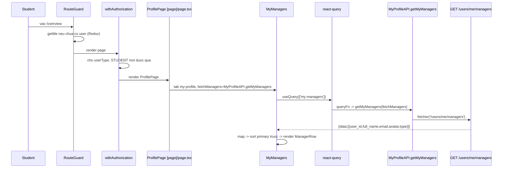

# Architecture — lms-fe

> Nguồn: `origin/staging` @ `baf430fa7`. Conventions của repo (đọc trước khi thiết kế): `.claude/CLAUDE.md`, `.claude/rules/01-code-placement.md`, `03-architecture-patterns.md`, `04-imports-and-dependencies.md`, `05-ui-and-styling.md`, và `.claude/inventory/01..05`. File này không chép lại chúng; chỉ ghi điều đã kiểm trong code và chỗ code khác với rules.

## Architecture Analysis

### System Overview

Monorepo pnpm workspaces + Turborepo (`pnpm-workspace.yaml:1-8`, `turbo.json:1-31`). Ba app Next.js 14 App Router (`apps/lms-pro`, `apps/lms-test`, `apps/lms-zoom`) lắp ghép từ:

- `libs/*` hạ tầng dùng chung: `@lms/api` (HTTP + API class), `@lms/contexts` (thư mục `libs/state`: Redux slice + React context), `@lms/core` (type/constant/enum), `@lms/hooks`, `@lms/hoc`, `@lms/ui`, `@lms/utils`, `@lms/assets`, `@lms/styles`.
- `features/*` module nghiệp vụ `@lms/feature-*`, mỗi cái xuất qua `src/index.ts` (field `main`, ví dụ `features/user/package.json`).
- `@upbase-tech/*` package ngoài từ repo `lms-package` (auth, design-tokens, common, notification, quiz-result, explanation); khai báo trong `apps/lms-pro/package.json`, `libs/*/package.json`.

### Architectural Style

Client-driven SPA trên Next.js: root layout là server component chỉ lo font/metadata/CSS, mọi thứ còn lại là client (`apps/lms-pro/src/app/layout.tsx:111-147` bọc `ProvidersWrapper` trong `Suspense`; comment ở `layout.tsx:87-88` nói app "client-driven, data fetch ở client"). `output` là `standalone`, hoặc `export` khi `NEXT_EXPORT=true` (`apps/lms-pro/next.config.js:35-37`).

### Component Relationships

```mermaid
flowchart TD
  L[layout.tsx server] --> PW[ProvidersWrapper: Redux Provider]
  PW --> P[Providers: Antd cfg, PinnedNotify, FeatureProvider, Course*, QueryClientProvider, Toaster]
  P --> AP[AuthProvider @upbase-tech/auth-package]
  AP --> RG[RouteGuard @lms/feature-auth]
  RG --> PG[page.tsx per route, often withAuthorization]
  PG --> F[features/* components]
  F --> UI[@lms/ui, @lms/hooks, @lms/contexts]
  PG --> API[app src/api/* re-export @lms/api]
  API --> HC[libs/api/client.ts fetcher/axios]
  HC --> BE[(lms-be REST NEXT_PUBLIC_BASE_API_URL)]
```

Text fallback: `layout.tsx` -> `ProvidersWrapper` (`providers.tsx:393-399`) -> `Providers` -> `AuthProvider` -> `RouteGuard` -> page -> feature component -> `fetcher` (axios) -> BE.

### Data Flow

Trang gọi API class (`XxxAPI`/object) -> `fetcher` của `@lms/api` -> axios `request` -> BE. Dữ liệu server state đi qua react-query v3 (`useQuery(key, fn, opts)`); dữ liệu người dùng đăng nhập nằm trong Redux slice `userReducer` (nạp bằng thunk `getMe` trong `RouteGuard`). App truyền các API class vào feature qua `FeatureProvider` (`providers.tsx:167-210`) hoặc truyền thẳng qua props (trường hợp `MyManagers`).

### Key Design Decisions

- **Dependency injection qua `FeatureContext`**: `features/*` không import `@lms/api`; app đưa API/router/dispatch vào context (`libs/state/contexts/FeatureContext.tsx:34-97`). `features/user/package.json` không khai `@lms/api`, và `my-managers.service.ts:7-8` ghi rõ lý do hàm gọi API do app truyền vào.
- **Slot/Extension registry** cho UI nhúng khác feature: `ExtensionRegistry.register(slot, Component)` và `<Slot name>` (`libs/ui/extensions/ExtensionRegistry.ts`, `Slot.tsx:11-25`). Gamification đăng ký `GAMIFICATION_PAGE` và `GAMIFICATION_BADGES_TAB` (`features/gamification/src/module.tsx:11-12`); tab Badges của trang hồ sơ dùng `<Slot name="GAMIFICATION_BADGES_TAB" />` (`page.tsx:204`, `382`). Slot rỗng thì render `RedirectNotBuyPage` và `console.warn` (`Slot.tsx:13-16`).
- **Module registry**: `apps/lms-pro/src/app/module-registry.ts:11-18` gom `AppModule` (schedule, test, certificate, examination, attendance, gamification) import từ `./module` thay vì barrel để page không vào bundle chung.

### Improvement Opportunities

Xem `code-quality-assessment.md`.

## Limits that bite every feature

### Auth / authorization flow

1. `initAuth({...})` (Keycloak qua `@upbase-tech/auth-package`) chạy khi module `apps/lms-pro/src/utils/helpers/keycloak.ts` được import; cấu hình lấy từ `NEXT_PUBLIC_KEYCLOAK_URL|REALM|CLIENT_ID` (`keycloak.ts:32-38`). Token chỉ ở RAM; cookie cũ bị xoá qua `clearLegacyCookies` (`keycloak.ts:44-51`). Logout: `localStorage.clear()` và xoá cookie `KEYCLOAK_USER_ID` (`keycloak.ts:60-63`).
2. `AuthProvider` bọc `RouteGuard`, hết hạn chờ 10 s thì toast lỗi và render tiếp (`providers.tsx:131-137`, `363-369`).
3. `RouteGuard` (`features/auth/src/components/RouteGuard.tsx:11-91`): nếu route chứng chỉ công khai thì cho qua (`isPublicCertificateRoute`); nếu Redux đã có `user.id`/`keycloak_user_id` thì cho qua và ghi cookie `KEYCLOAK_USER_ID`; nếu chưa có thì `dispatch(getMe(userContextApi))`, thất bại thì **vẫn hiện spinner**, không redirect (`RouteGuard.tsx:57-66`, `84-90`).
4. Phân quyền theo vai trò ở từng page: `withAuthorization(allowedRoles)(Component)` (`libs/HOC/src/withAuthorization.tsx:6-51`). Hành vi: chờ 100 ms và chờ `userType`, hiện `UpBaseLoadingGlobal`; ở `/` thì đẩy TEACHER sang `pageLink.MY_CALENDAR`, STUDENT sang `COURSES`; role không nằm trong `allowedRoles` thì `router.replace(pageLink.COURSES)` và không render (`withAuthorization.tsx:14-44`). `UserType` chỉ có `STUDENT` và `TEACHER` (`libs/state/redux/types/User/urser.ts:78-81`). Chưa gán role = spinner vô hạn.
5. HTTP: header `Authorization: Bearer` được gắn bởi interceptor sau `auth.waitUntilReady()` (`apps/lms-pro/src/services/request.ts:9-23`); 401 thì `refreshAuth()` (`keycloak.updateToken`) và retry một lần, hàng đợi subscriber (`libs/api/client.ts:127-202`). Mọi lỗi mã bắt đầu `403` thì `window.location.href = '/'` (`client.ts:221-225`).

### How pages get data (react-query + fetcher)

- `QueryClient` tạo một lần ở module (`providers.tsx:109-116`) với `staleTime: 3000000` (50 phút) và `refetchOnWindowFocus: false`. Query cần số mới phải tự override (`MyManagers` chỉ set `refetchOnWindowFocus:false`, nên dùng cache 50 phút: `MyManagers.tsx:56-60`).
- `fetcher(url, cfg)` trả `res.data` của axios (`client.ts:109-114`); `validateStatus` chấp nhận 2xx và 304; timeout 30 s (`client.ts:100-103`); `baseURL = NEXT_PUBLIC_BASE_API_URL` chỉ phía client (`client.ts:95-97`).
- `configureHttpClient` phải chạy trước mọi API call, nếu không `getActiveClient()` ném lỗi (`client.ts:269-276`). Mỗi app gọi một lần: lms-pro `src/services/request.ts`, lms-test `src/services/requestV2.ts`.
- Query key: mỗi feature tự khai. Gamification dùng `["gamification", ...]` (`features/gamification/src/constants/keys.ts:4-20`); `MyManagers` dùng `['my-managers']` (không gắn id người dùng; `MyManagers.tsx:57`). Hook `useGamificationVisibility` chỉ đọc cache của key `["gamification","me"]` (`enabled:false`) và không tự fetch (`libs/hooks/useGamificationVisibility.ts:68-73`); nguồn nạp là `useGamificationBootstrap` (`features/gamification/src/hooks/useGamificationData.ts:30-52`), được gọi ở `features/gamification/src/realtime/GamificationRealtime.tsx:61`, và component này được mount trong `client-layout.tsx:59-66`. Hệ quả cho trang hồ sơ: tab Badges chỉ hiện khi query `me` đã thành công và `features.badges` bật (`page.tsx:86-87`, `244-253`); khi chưa có kết quả thì `badges=false`.

### App Router: client/server boundary

- `layout.tsx` (server) chỉ chứa metadata, font, CSS và `Suspense`; mọi page đã đọc đều `'use client'` (`[page]/page.tsx:1`, `app/page.tsx:1`, `error.tsx:1`). `[page]/layout.tsx` là server component, dùng `notFound()` để chặn slug lạ (`[page]/layout.tsx:13-26`).
- Route động `[page]` bắt mọi path một cấp: slug hợp lệ chỉ `overview`, `devices`, `login_history`, `change_password` (`MYPROFILE_TREE`, `SECURITY_TREE`, `libs/core/constants/User.ts:60-61`; `[page]/layout.tsx:6`), `generateStaticParams` chỉ trả `overview` (`[page]/layout.tsx:8-11`). Route mới phải là folder riêng, nếu không rơi vào `notFound()` (rule ở `.claude/rules/03-architecture-patterns.md`).
- Nhiều đoạn dùng `dynamic(..., { ssr:false })` cho popup nặng (`providers.tsx:74-96`).

### Error handling

- API: interceptor toast lỗi (`react-hot-toast`) theo `ExceptionErrorCode`; bỏ qua toast khi `silent:true`, khi mã nằm trong `toastExceptions` (danh sách ở `client.ts:42-55`, gồm `404|630001` của gamification tắt), khi huỷ request, khi trình duyệt đang điều hướng, hoặc 401 chung (`client.ts:80-89`, `214-219`).
- UI: `app/error.tsx` hiển thị trang Oops và nút về `/` (`error.tsx:7-37`); có `global-error.tsx`, `not-found.tsx`, Sentry (`@sentry/nextjs`, `next.config.js:1-3`).
- Query lỗi: tuỳ component. `MyManagers` có nhánh `isError` riêng (`MyManagers.tsx:71-74`).

### i18n / locales

Không có lớp i18n đang chạy (xem `business-overview.md`). Mọi chuỗi hardcode; mỗi component tự chọn tiếng Việt hay tiếng Anh. Khi cần chuỗi đúng nguyên văn PRD (tiếng Việt), phải sửa thẳng trong component.

### Sharing `@lms/*` and `@upbase-tech/*`

- `@lms/*` là tên package workspace (`workspace:*`), không phải `paths` của tsconfig (`.claude/rules/04-imports-and-dependencies.md`). Mỗi lib có `main: ./index.ts` nên import thẳng source TS (ví dụ `libs/api/package.json`, `libs/hooks/package.json`).
- Điểm lệch cần biết: `libs/HOC/src/withAuthorization.tsx:4` import `UpBaseLoadingGlobal` bằng đường dẫn tương đối `'../../ui'`, dù `libs/HOC/package.json` chỉ khai `@lms/contexts`; `libs/HOC/package.json` còn khai `react-router-dom` không thấy dùng trong file đã đọc.
- `@upbase-tech/design-tokens` được dùng ở `providers.tsx:56`, `layout.tsx:3` và khai trong `apps/lms-pro/package.json`, `libs/ui|hooks|utils/package.json`, nhưng không có trong bảng package ngoài của `.claude/rules/04-imports-and-dependencies.md`.
- Package ngoài không đi theo workspace: registry GitHub Packages, token cấu hình riêng (`.claude/rules/04...`); bug trong package phải sửa ở repo `lms-package`.

## Interaction Diagrams

### Học viên mở hồ sơ và xem My Managers



Text fallback: `RouteGuard` nạp user -> `withAuthorization([STUDENT])` -> `ProfilePage` -> `MyManagers` gọi `useQuery(['my-managers'])` -> `getMyManagers(MyProfileAPI.getMyManagers)` -> `GET /users/me/managers` -> map DTO -> sort quản lý chính lên đầu -> render.

## Learner profile deep slice

Ghi chú đầy đủ ở `areas/learner-profile.md`. Tóm tắt: trang hồ sơ là client component, mount `MyManagers` ở hai chỗ (tab desktop `page.tsx:194`, Collapse mobile `page.tsx:277`), component nhận hàm fetch qua props và tự quản react-query.
