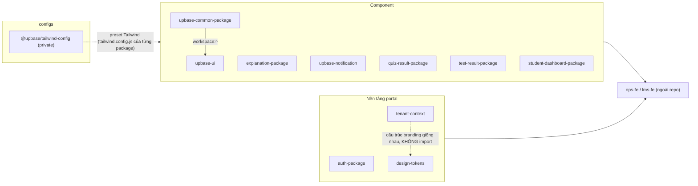
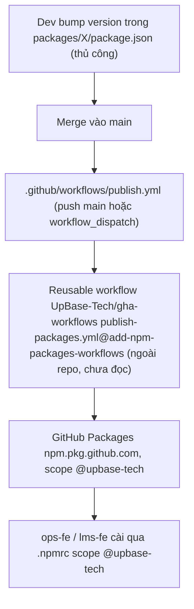
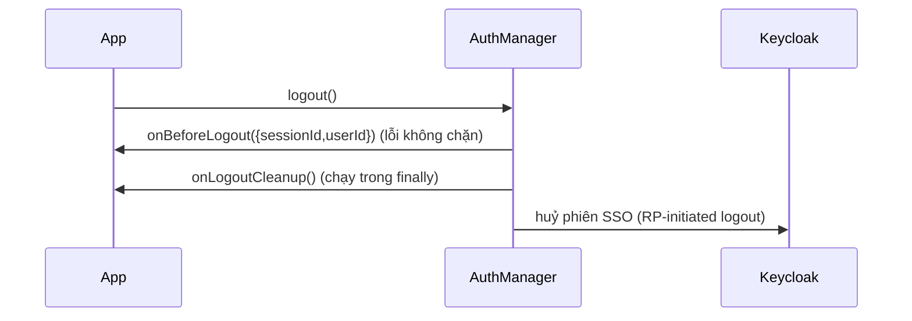

# Architecture — lms-package

> Overview (Depth Minimal), `origin/main` @ `448d575`. Chỉ ghi những gì đã đọc ở cấp `package.json`, config build, file entry và README.

## Architecture Analysis

### System Overview

Monorepo thư viện, không có ứng dụng. Mỗi thư mục con của `packages/` là một package độc lập được build bằng Vite library mode ra `dist/` rồi publish riêng lên GitHub Packages (`pnpm-workspace.yaml:1-3`, `packages/*/package.json` mục `scripts.build` và `publishConfig`). Turbo chạy `build/dev/lint/test` cho cả workspace (`package.json:6-11`, `turbo.json:3-16`).

### Architectural Style

Hai họ package, khác nhau về hình dạng đóng gói (đều là kết luận từ `package.json` và `vite.lib.config.ts`):

| Họ | Package | Đặc điểm |
|---|---|---|
| Lõi không-React + lớp React tuỳ chọn, có `types` | `auth-package`, `tenant-context`, `design-tokens` | `"type": "module"`, `"sideEffects": false`, `.d.ts` sinh bằng `tsc -p tsconfig.build.json` sau `vite build` (`packages/auth-package/package.json:11,32,37-39`); React là peer tuỳ chọn (`:44-52`) |
| Thư viện component React | `upbase-common-package`, `explanation-package`, `upbase-notification`, `quiz-result-package`, `test-result-package`, `student-dashboard-package`, `upbase-ui` | Vite lib `es`+`cjs`, một entry `src/index.tsx`, CSS nhét vào JS bằng `vite-plugin-css-injected-by-js`; `dist/index.css` chỉ là file rỗng để tương thích ngược (`packages/common-package/vite.lib.config.ts:11-14`, `packages/common-package/scripts/postbuild-css-stub.cjs:1-11`). Không có file `.d.ts` build cho nhóm này (script build không có bước `tsc`, `packages/common-package/package.json:30`) |

Chi tiết quyết định thiết kế đã thấy trong code:
- `auth-package` có hai entry (`.` và `./react`) để portal không dùng React vẫn import được lõi (`packages/auth-package/vite.lib.config.ts:7-8,16-19`); `keycloak-js` bắt buộc external để chỉ có một adapter trên trang (`:27-29`).
- `tenant-context` chỉ build một entry `src/index.ts` (`packages/tenant-context/vite.lib.config.ts:15`) và `exports` chỉ có `.` và `./package.json` (`packages/tenant-context/package.json:16-23`), dù thư mục `src/react/` và `src/server/` có mã (`packages/tenant-context/src/react/index.ts:1-17`, `src/server/index.ts:1-16`). README của chính package cũng nói "Chưa có ... provider React · đọc header ở server" (`packages/tenant-context/README.md:112-113`). Tức là hai thư mục đó có trong source nhưng không được build/export ở `origin/main`.
- `explanation-package` bọc UI trong `react-shadow` (`<root.div mode='closed'>`) cùng styled-components để cô lập CSS khỏi app chủ (`packages/explanation-package/src/index.tsx:55-66`; `vite.lib.config.ts:8-10`).
- `upbase-common-package` phụ thuộc workspace vào `@upbase-tech/upbase-ui` (`packages/common-package/package.json:68`) và re-export `UI_VERSION`, `UiVersionBadge` từ đó (`packages/common-package/src/index.tsx:3`).

### Component Relationships

Text fallback: `upbase-common-package` phụ thuộc workspace vào `upbase-ui` (`packages/common-package/package.json:68`); các package khác trong `packages/` không phụ thuộc lẫn nhau theo `dependencies` đã đọc. `design-tokens` có cấu trúc `branding` giống `TenantBranding` của `tenant-context` nhưng không import nó (`packages/design-tokens/README.md:43`). Mũi tên "preset Tailwind" dựa vào README của `tailwind-config` (`configs/tailwind-config/README.md:10-23`), chưa kiểm tra `tailwind.config.js` của từng package ngoài `common-package` (`packages/common-package/tailwind.config.js:1-3` có `content` và `corePlugins.preflight=false`, nhưng không thấy `presets` trong 10 dòng đầu).

### Data Flow

Không có luồng dữ liệu phía server trong repo này. Luồng đáng chú ý nằm ở phía app dùng thư viện, theo README:
1. App gọi `initAuth(config)` một lần; token chỉ ở bộ nhớ (`packages/auth-package/README.md:36-58`).
2. Sau `GET /me`, app gọi `tenantContextFromMe(me)` rồi `getTenantManager().hydrate(ctx)` (`packages/tenant-context/README.md:44-50`).
3. App đưa `branding` vào `renderTokenCss` (SSR, Next.js) hoặc `applyTokens` (SPA Vite) (`packages/design-tokens/README.md:64-81`).

### Key Design Decisions

| Quyết định | Bằng chứng |
|---|---|
| Version bump tay trong `package.json`, publish tự động khi push `main` | `.github/workflows/publish.yml:3-7,14-18`; commit `448d575` sửa `"version": "1.0.11" -> "1.1.0"` ở `explanation-package` |
| Preflight Tailwind tắt trong thư viện để không leak style | `configs/tailwind-config/README.md:19-21`, `packages/common-package/tailwind.config.js:3` |
| `UpbaseCalendarV2` viết SCSS thuần, ngoại lệ so với chuẩn Tailwind | `configs/tailwind-config/README.md:74` |
| Mỗi export là một cam kết semver, nên export tối thiểu | `packages/design-tokens/README.md:28-30`, `packages/tenant-context/README.md:33-35` |
| Mặc định "mở" khi tenant không khai `features` | `packages/tenant-context/README.md:94-102` |

### Improvement Opportunities

Chỉ nêu điều đã thấy (xem thêm `code-quality-assessment.md`): `tenant-context` có mã `react/` và `server/` chưa export; hai họ package có chuẩn đóng gói khác nhau (có/không `types`, có/không `sideEffects`).

## Interaction Diagrams

### Build và publish

Text fallback: bump tay `version` -> merge `main` -> `publish.yml:3-7` kích hoạt -> `publish.yml:18` gọi workflow dùng chung (nội dung nằm ở repo `gha-workflows`, chưa đọc, nên việc nó có chỉ publish package đổi version hay không là chưa xác minh) -> GitHub Packages (`.npmrc:2`).

### Luồng đăng xuất (theo hợp đồng `AuthManager`)

Text fallback: `logout()` gọi hook nghiệp vụ, dọn cục bộ, rồi huỷ phiên SSO (`packages/auth-package/src/core/types.ts:130-131`; thứ tự và hành vi lỗi của hook: `types.ts:69-82`). Thân hàm `logout` trong `auth-manager.ts` chưa đọc.
