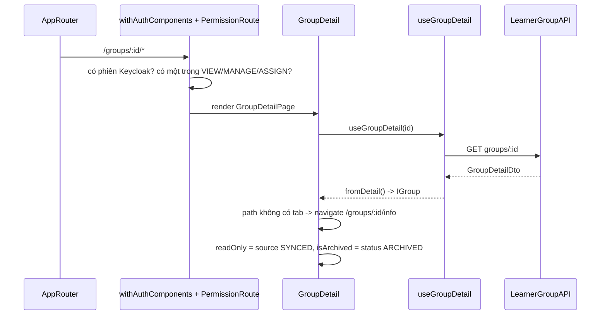
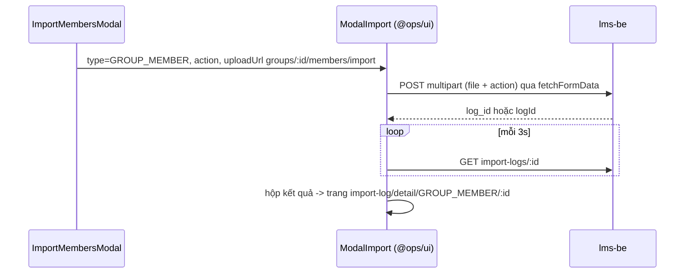

# Architecture — ops-fe

> `origin/staging` @ `40f66b247`. Quy ước của repo (không chép lại): `ops-fe:.claude/CLAUDE.md`, `ops-fe:.claude/rules/03-architecture-patterns.md`, `04-imports-and-dependencies.md`, `05-ui-and-styling.md`. Danh mục có sẵn: `ops-fe:.claude/inventory/04-state.md`, `05-api.md`.

## Architecture Analysis

### System Overview

SPA React 18 + Vite, một app (`apps/ops-fe`) lắp ráp từ 17 feature module cắm được (`ops-fe:apps/ops-fe/src/module-registry.ts:20-38`) trên các lib dùng chung. Backend là `lms-be` app `ops` (REST, phong bì `{success,data,error}`), gọi qua một axios instance chung.

### Architectural Style

Frontend monorepo theo kiểu "micro-feature in one bundle": mỗi feature export `AppModule { name, routes, pageLink, sidebarIds? }` (`ops-fe:libs/core/src/types/common.ts:42-47`); app gộp route, `PageLink` và id sidebar lúc khởi động. Không Redux; server state do react-query v3, state chia sẻ bằng Context.

### Component Relationships

```mermaid
flowchart TD
  idx[apps/ops-fe/src/index.tsx] -->|initApp| boot[bootstrap.ts]
  boot --> reg[module-registry.ts: modules[]]
  idx --> FP[FeatureProvider: ~57 *API + PageLink + permissionsToCheck]
  FP --> SB[SidebarProvider initSidebarIds]
  SB --> QC[QueryClientProvider]
  QC --> AP[AuthProvider Keycloak]
  AP --> UP[UserProvider: GET /me]
  UP --> GATE[OpsAccessGate]
  GATE --> CP[CourseProvider] --> LP[LoadingProvider] --> APP[App: antd ConfigProvider + AppRouter]
  APP --> RT[AppRouter renders modules[].routes]
  feat[features/*] -->|useFeature| FP
  feat --> libs[libs/ui, hooks, core, utils]
  libs --> svc[libs/service request.ts]
  svc --> BE[(lms-be ops API)]
```

Text fallback: `index.tsx` gọi `initApp()` rồi render `FeatureProvider > SidebarProvider > QueryClientProvider > AuthProvider > UserProvider > OpsAccessGate > CourseProvider > LoadingProvider > App` (`ops-fe:apps/ops-fe/src/index.tsx:131-215`). `App` bọc `HelmetProvider > LayoutProvider > ConfigProvider(antd) > ErrorBoundary > AppRouter` (`ops-fe:apps/ops-fe/src/App.tsx:16-33`). Lệch nhỏ so với `rules/03-architecture-patterns.md:25-28`: thứ tự thật có `AuthProvider` và `OpsAccessGate` xen giữa.

### Data Flow

Component → hook của feature (`useQuery`/`useMutation` từ `react-query`) → `useFeature().XxxAPI` → static method gọi `fetcher(url, cfg)` → axios `request` (interceptor gắn Bearer, xử lý 401, toast lỗi) → BE. DTO snake_case được đổi sang kiểu feature trong adapter (Group: `features/group/src/services/api-adapter*.ts`).

### Key Design Decisions

1. **DI qua `FeatureContext`**: feature khai interface API ở `@ops/core`, app implement và inject; feature không import `apps/ops-fe` (`ops-fe:libs/state/src/context/FeatureContext.tsx:4-75`, `ops-fe:apps/ops-fe/src/index.tsx:131-193`).
2. **Module registry + PageLink merge**: `buildPageLink()` trộn `DEFAULT_PAGE_LINK` với `pageLink` của mọi module; trùng khoá thì module thắng (`ops-fe:apps/ops-fe/src/bootstrap.ts:5-18`).
3. **White-label**: `module-registry.ts` bị sinh lại, feature không cần thì bị xoá thư mục (`ops-fe:scripts/generate-customer.js`).

### Improvement Opportunities

Xem `code-quality-assessment.md` (CI không lint/typecheck, không test, mock còn sót trong Group, tài liệu `.claude` lệch code).

## Các giới hạn ảnh hưởng mọi feature

### Auth (Keycloak)

- `initAuth({ resolveConfig })` đọc `VITE_KEYCLOAK_URL|REALM|CLIENT_ID`; logout dọn `localStorage` (`ops-fe:apps/ops-fe/src/services/auth.ts:16-27`). Khởi động còn xoá token cũ `actToken`/`refreshToken` (`:9-14`).
- `setRequestConfig({ getAuthHeader, refreshAuth })` chờ `auth.waitUntilReady()` rồi trả `Bearer <token>` (`ops-fe:apps/ops-fe/src/index.tsx:97-105`); interceptor request gắn header (`ops-fe:libs/service/src/request.ts:105-114`).
- 401 → thử `refreshAuth()` một lần (`_retry`), hàng đợi subscriber, lỗi thì reject (`:116-170`).
- Route guard: `withAuthComponents` gọi `manager.login()` nếu chưa đăng nhập, render `null` trong lúc đó (`ops-fe:libs/HOC/src/with-auth-components.tsx:4-19`). Không có trang login/quên mật khẩu (route bị comment, `ops-fe:apps/ops-fe/src/routes/AppRouter.tsx:49-59`).
- **Lệch tài liệu**: `rules/03-architecture-patterns.md:40-43` ghi "KHÔNG Keycloak", token act/rft, `POST /auth/rotate`; code thật dùng Keycloak (`.claude/CLAUDE.md:26` và `docs/features/sso-keycloak.md` mới đúng).
- Sau đăng nhập `UserProvider` gọi `GET /me` (`ops-fe:apps/ops-fe/src/apis/user/index.ts:59-61`), lưu `profileMe`, nạp tenant (`applyTenantFromMe`), đặt `accessDenied` khi 403 `FORBIDDEN_DOMAIN_ACCESS` (`ops-fe:libs/state/src/context/UserProvider.tsx:160-190`). `OpsAccessGate` giữ màn chờ tới khi `/me` xong, rồi hiện `AccessDenied` hoặc app (`ops-fe:apps/ops-fe/src/components/access-denied/index.tsx:44-57`).

### Permission và sidebar flow

1. Quyền là chuỗi `gr_*` nằm trong `profileMe.roles[].permissions`; `SUPER_ADMIN` qua mọi kiểm tra (`ops-fe:libs/hooks/src/permission/useHasPermission.tsx:13-43`).
2. Route: `PermissionRoute permissions=[...]` cho vào nếu có **một** quyền trong danh sách; trả `null` khi chưa có `profileMe`, `PageAccessDenied` khi thiếu (`ops-fe:libs/ui/src/common/permission-route/PermissionRoute.tsx:13-24`). Cách dùng: bọc `withAuthComponents` ngoài, `PermissionRoute` trong (`ops-fe:features/group/src/routes.tsx:19-33`).
3. Sidebar: mỗi module khai `sidebarIds`; `bootstrap` gộp, `SidebarProvider` thêm vào `visibleSidebarList` (cùng danh sách mặc định cứng) (`ops-fe:libs/state/src/context/SidebarContext.tsx:25-47`). `useMenuData` dựng menu, mỗi mục có `showMenu: visibleSidebarList.includes(id)`; với người không phải admin còn lọc theo quyền trong `switch (item.id)` — **id không có `case` thì bị loại** (`default: return null`) (`ops-fe:libs/hooks/src/permission/useMenuData.tsx:833-897`). Thêm menu mới = thêm item + `case` cho id đó.
4. Bản đồ `permissionsToCheck` (`allowRender*` → khoá) inject qua FeatureProvider, nguồn `ops-fe:apps/ops-fe/src/constants/sidebar.ts:25-…`.
5. Cờ theo quan hệ (không theo `gr_*`): `useTeamAccess` đọc `is_group_manager`, `is_group_mentor` từ `/me` (`ops-fe:libs/hooks/src/permission/useTeamAccess.ts:14-19`), dùng cho `My Team` ở sidebar/route/HomeRedirect.
6. Chỉ ẩn lối vào ở FE; BE chặn thật (`ops-fe:features/group/src/hooks/useGroupPermissions.ts:8-9`).

### DI qua FeatureContext

`FeatureContextProps` liệt kê từng `XxxAPI: IXxxAPI` (`ops-fe:libs/state/src/context/FeatureContext.tsx:4-67`). Muốn thêm API: (1) khai `IXxxAPI` trong `libs/core/src/types/`, (2) thêm vào `FeatureContextProps`, (3) viết static class ở `apps/ops-fe/src/apis/<domain>/`, (4) truyền vào `<FeatureProvider value>` ở `index.tsx`. Với Group: `ILearnerGroupAPI` (`libs/core/src/types/learner-group.ts:554`), `LearnerGroupAPI` (`apis/learner-group/index.ts:71`), wire ở `index.tsx:146`. Class không dùng `implements` vì interface tả mặt tĩnh; kiểu được kiểm khi truyền vào provider (`apis/learner-group/index.ts:67-70`). Các lib (`libs/ui`) cũng đọc API qua `useFeature` (ví dụ `libs/ui/src/base/mobile/FilterMobile.tsx:1387,2033` dùng `LearnerGroupAPI.getOptions`).

### react-query: key và invalidation

- Mặc định client: `refetchOnWindowFocus: false`, `retryDelay` luỹ thừa tối đa 30s (`ops-fe:apps/ops-fe/src/index.tsx:107-114`).
- Group dùng **key factory theo feature** `groupKeys` với gốc `['groups']` (`ops-fe:features/group/src/hooks/groupKeys.ts:3-17`), `peopleKeys`, `myTeamKeys` (gốc `['group-my-team']`).
- Mutation của Group đa số `qc.invalidateQueries(groupKeys.all)` (cả nhánh, không từng key): `useGroupMutations.ts:24,44,59,105,120,132`, `useGroupMembers.ts:191,203`, `useSupervisors.ts:46,60`.
- `useAppMutation` (`ops-fe:libs/hooks/src/use-app-mutation.tsx:30-60`: toast thành công + invalidate theo `queryKey`/`queryKeyPrefix`) **có sẵn nhưng feature Group không dùng**, nó dùng `useMutation` của react-query trực tiếp (grep `useAppMutation` trong `features/group/src` chỉ khớp ghi chú ở `CLAUDE.md`).
- Quy tắc "mọi query phân trang gửi đủ `page_index` + `page_size`" của BE Group: `areas/group.md`.

### Lỗi và toast

- Interceptor response của `libs/service` tự `toast.error` cho mọi lỗi **trừ** 422, 413, `/me` 403 và mã trong `toastExceptions`; message lấy từ `en.exceptions.json` theo `error.code`, 5xx dùng câu chung "Có lỗi xảy ra…" (`ops-fe:libs/service/src/request.ts:172-241`). Lỗi `others[].errors[].message` cũng toast riêng (`:243-274`).
- Mã lỗi Group (`404|640001`, `400|640002…640011`, `403|640020`) có trong `en.exceptions.json` (dòng 2267-2344). Enum `LearnerGroupErrorCode` ở `libs/core/src/types/learner-group.ts:269-281` **không được feature nào dùng**.
- Hệ quả: mutation không cần toast lỗi riêng; cần bỏ qua lỗi 5xx đã toast (`ops-fe:features/group/src/utils/server-error.ts:4-5`).
- `ErrorBoundary` bọc `AppRouter` (`App.tsx:26-28`).

### i18n

Không có i18n runtime. Chuỗi UI hardcode; nhãn Group ở `features/group/src/constant/index.ts` (tiếng Anh theo CR7, chỗ chưa có chuỗi PO giữ tiếng Việt kèm `TODO(copy)`, `:3-6,84-87`). Thông báo lỗi API: `libs/service/src/en.exceptions.json`.

### Đăng ký một feature mới

1. Tạo `features/<name>/` với `package.json` (`name: @ops/feature-<name>`, `main: src/index.ts`, deps `@ops/*: workspace:*`) và `src/index.ts` export `<name>Module: AppModule` (mẫu `ops-fe:features/group/src/index.ts:5-10`).
2. Thêm `"@ops/feature-<name>": "workspace:*"` vào `apps/ops-fe/package.json` (mẫu `:19`).
3. Import và thêm vào mảng `modules` ở `apps/ops-fe/src/module-registry.ts` (file này bị `pnpm gen` ghi đè).
4. Nếu cần menu: thêm id vào `ID_SIDE_BAR` (`libs/core/src/constants/permission.ts`), item + `case` ở `useMenuData.tsx`, id vào `sidebarIds` của module.
5. Nếu cần API: bốn bước ở mục DI.
6. White-label: thêm vào `FEATURE_MODULE_MAP`, `FEATURE_FOLDER_MAP` (và `REQUIRED_FEATURES` nếu luôn có) ở `ops-fe:scripts/generate-customer.js:11-56`. Group nằm trong `REQUIRED_FEATURES` vì `features/user` phụ thuộc ngược `@ops/feature-group` (`:15-16`).
7. Alias Vite chỉ có sẵn cho `class-and-course` và `group` (`vite.config.ts:28-32`); feature khác resolve qua workspace.

## Interaction Diagrams

### Mở chi tiết nhóm (đọc)



Text: route `/groups/:id/*` qua guard, `GroupDetail` lấy chi tiết (`GET groups/:id`), đổi DTO sang `IGroup`, chọn tab theo phân đoạn URL, mặc định chuyển sang `info` (`ops-fe:features/group/src/components/groups/GroupDetail/GroupDetail.tsx:25-49,56-70`); nhóm không tồn tại thì `Navigate` tới `/404` (`:77-87`).

### Nhập thành viên bằng tệp



Text: `ops-fe:features/group/src/components/groups/ImportMembersModal/ImportMembersModal.tsx:57-86`; `ops-fe:libs/ui/src/base/upload-file/ModalImport.tsx:240-242,253,273-277`. Trang `import-log/detail/:type/:id` do `features/schedule` đăng ký (`ops-fe:features/schedule/src/routes.tsx:101-104`), nghĩa là Group phụ thuộc ngầm vào feature `schedule` có mặt trong bản build.
